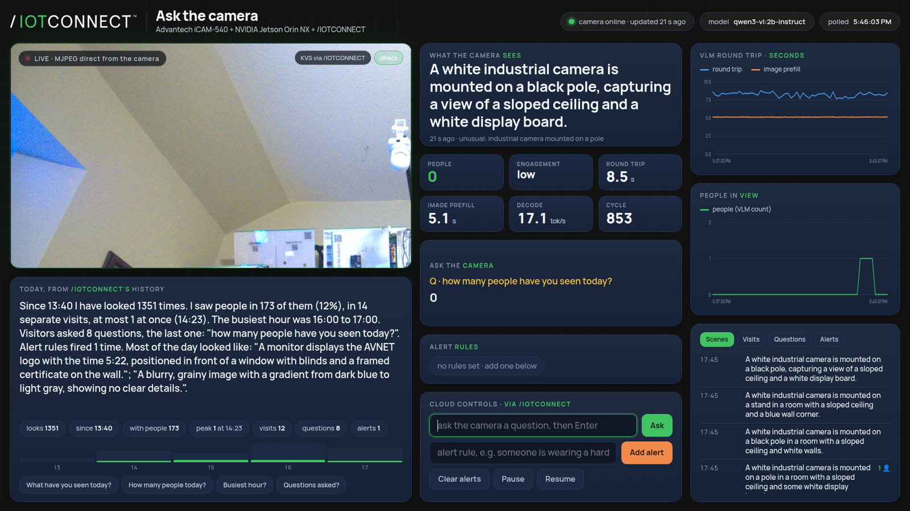
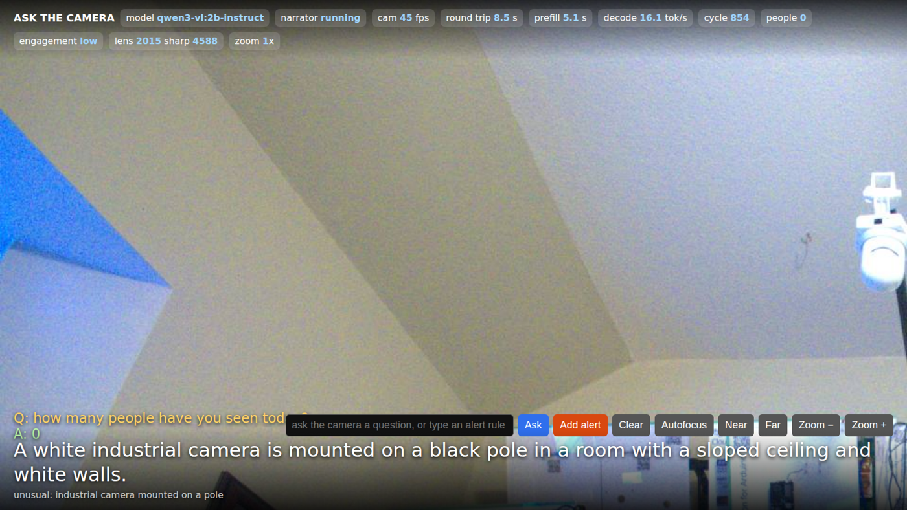

# Ask the camera: a vision-language narrator on the iCAM-540, on /IOTCONNECT

A 2-billion-parameter vision-language model (VLM) runs on the Advantech iCAM-540's Jetson Orin NX, looks at the live sensor every few seconds and tells /IOTCONNECT what it sees. Visitors ask the camera questions and set plain-English alert rules from the cloud, watch the live video through Kinesis Video Streams, and a booth web page fed entirely by /IOTCONNECT's API shows the whole story, including what the camera has seen today.

Status: **validated end to end on the iCAM-540 (Orin NX 8 GB, JetPack 6.2) on 2026-10-09**, with the booth page running both on the camera and on an EC2 instance.



## 1. What the demo does

- **Narration.** Every ~10 s the camera publishes `scene_caption` (one sentence), `people_vlm`, `engagement`, `unusual`, plus timing (`vlm_latency_ms`, `vlm_prefill_ms`, `vlm_tok_s`, token counts) to /IOTCONNECT.
- **Ask the camera.** A free-text question sent as a cloud command is answered against the latest frame and published as `question` / `answer`.
- **Alert rules.** Up to three plain-English rules ("someone is wearing a hard hat") are evaluated every cycle into `alert_1..3`, `alerts_active`, `alert_text`.
- **Live video in /IOTCONNECT.** The camera is a KVS WebRTC master; the portal's Video Streaming tab and the booth page both play it with sub-second latency.
- **The booth page.** One screen, no scrolling, sized to the display: the live picture, the caption, people and engagement, the Q&A, the alert rules, round-trip and people charts, the day's timeline, and an ask box. Everything on it comes from /IOTCONNECT's REST API; questions about the day ("what have you seen today?") are answered from the day's telemetry history, not by the camera.
- **A live view on the camera itself** (`http://<camera>:8088/`) with the picture, the narration, autofocus and zoom controls, for setup and for the HDMI display.

Talk track: show the caption updating; type a question (Enter sends) and watch the answer arrive through the cloud ~15 s later; type an alert rule and have someone trigger it; press "What have you seen today?".

## 2. How it fits together

```
 iCAM-540 (Orin NX 8 GB, JetPack 6.2)                                  cloud
 +--------------------------------------------------------------+
 |  sensor /dev/video0 --(v4l2-ctl, 1080p YUYV 60 fps)-->       |
 |     vlm_narrator.py  (vlm-narrator.service)                   |      /IOTCONNECT
 |        capture thread, lens autofocus, digital zoom            |      +------------------------------+
 |        every ~10 s: frame --> Ollama qwen3-vl:2b-instruct     |      |  MQTT (AWS IoT Core)          |
 |        telemetry + command acks --> iotc.sock                  |      |  device template "Vision Arena"|
 |        commands <-- iotc_cmd.sock                              |      |  dashboard, Video Streaming tab|
 |        live view http://camera:8088  (MJPEG + state + ask)     |      |  REST API                      |
 |  /IOTCONNECT snap (iotconnect.socket)  <--MQTT-->  -----------+----->|                                |
 |  kvs_webrtc.py (kvs-webrtc.service): KVS WebRTC master ------+----->|  Kinesis Video Streams (WebRTC)|
 |  booth_site.py (booth-site.service, optional here)            |      +---------------+----------------+
 +--------------------------------------------------------------+                      |
                                                                                       | REST (telemetry, history,
 booth_site.py on EC2 (or on the camera): the show page  <-----------------------------+ commands, KVS viewer kit)
     http://<address>/   browsers at the booth, the HDMI kiosk, phones on the LAN
```

Two agents share the device, the template and the snap's command socket: this narrator and the [Vision Arena](../../advantech-icam540-vision-arena/) DeepStream agent. Each ignores, without an ack, the commands the other owns.

## 3. Quick start

### 3.1 In /IOTCONNECT

1. Import the device template [`icam540-arena-device-template.json`](../../advantech-icam540-vision-arena/files/icam540-arena-device-template.json) (67 attributes, 33 commands, both demos). Enable **Video Streaming** on it: Stream Type **USB Based**, Stream Resource **WebRTC** (what this demo uses; **Video Stream** is PutMedia, see 4.4).
2. Create the device with that template and that stream resource. The resource is fixed at creation: the AWS side provisions the KVS channel then.
3. Optionally import the dashboard [`icam540-arena-dashboard-template.json`](../../advantech-icam540-vision-arena/files/icam540-arena-dashboard-template.json) and re-select the device in its widgets; its "ASK THE CAMERA" section shows this demo.
4. For the booth page you need a **solution key** (Settings > Key Vault) and the account's **CPID / environment** (`poc` / `aws` on the bring-up account).

### 3.2 On the camera

```bash
# once, on the HDMI console (the image ships without SSH host keys)
sudo apt install -y openssh-server && sudo ssh-keygen -A && sudo systemctl enable --now ssh   # login icam-540 / icam-540: change it
# snap launcher workaround for this kernel (section 7), then the snap
echo SNAP_REEXEC=0 | sudo tee -a /etc/environment; echo 'export SNAP_REEXEC=0' | sudo tee /etc/profile.d/snap-no-reexec.sh
sudo mkdir -p /etc/systemd/system/snapd.service.d && printf '[Service]\nEnvironment=SNAP_REEXEC=0\n' | sudo tee /etc/systemd/system/snapd.service.d/no-reexec.conf; sudo systemctl daemon-reload; sudo systemctl restart snapd
sudo snap install iotconnect && sudo iotconnect.setup        # device credentials from the portal
# this demo
git clone -b icam540-ask-the-camera https://github.com/avnet-iotconnect/iotc-python-lite-snap-examples.git
cd iotc-python-lite-snap-examples/examples/advantech-icam540/ask-the-camera
./setup_vlm.sh                 # Ollama + qwen3-vl:2b-instruct, GPU runner, memory settings (minutes)
./install_service.sh           # vlm-narrator.service + the snap socket as a boot service
./install_webrtc.sh && sudo systemctl enable --now kvs-webrtc     # video into the Video Streaming tab
./install_booth.sh             # optional: the show page on the camera itself (edit /etc/default/booth-site)
sudo nvpmodel -m 3 --force     # 20 W power mode (reboots); 15 W starves the CPU with the model running
```

Then check: `journalctl -u vlm-narrator -f` shows `[TX] telemetry socket` and `[CMD] connected`, captions every ~10 s; the device's Live Data in the portal updates; the Video Streaming tab plays; `http://<camera>:8088/` shows the live view.

### 3.3 The booth page

- **On the camera**: `./install_booth.sh`, fill `/etc/default/booth-site`, `sudo systemctl enable --now booth-site`, open `http://<camera>:8090/`. The HDMI display opens it full-screen at boot through `~/.config/autostart/booth-kiosk.desktop` (`chromium --kiosk http://localhost:8090/?source=direct`; delete the file for the plain desktop).
- **In your AWS account** (the booth-ready option, nothing on the camera's network needed): `aws/deploy_ec2.sh` with the AWS CLI and a key that has `AmazonEC2FullAccess` creates a t4g.micro with a fixed Elastic IP, ships the site and settings, runs it as a locked-down service behind Caddy. `DOMAIN=booth.example.com ./aws/deploy_ec2.sh` after pointing a DNS record at the IP turns on HTTPS. `./aws/deploy_ec2.sh destroy` removes everything. About 7 USD a month.
- **Through a tunnel from the camera** (no account): `./install_tunnel.sh` runs a Cloudflare quick tunnel; the address is random and changes at every restart (`./install_tunnel.sh url`).

### 3.4 Unattended: plug in and it runs

Power and network are all the camera needs; no monitor, keyboard or login. At boot systemd starts Ollama, the snap's socket service (after the network is up, retrying until DNS answers), then the narrator, the KVS WebRTC master, the booth site and the tunnel, every one with `Restart=always` and no start limit. The narrator's unit declares `Conflicts=web.service autoui.service`, so the stock web UI is stopped before the sensor is opened and cannot take it back. The narrator keeps looking for the snap's sockets every 5 s until they exist, so it attaches even when the snap comes up after it. The lens position is saved to `.focus` after every autofocus or nudge and restored at the next start (about 4 s instead of a 30 s sweep); `focus sweep` forces a new sweep. The 20 W power mode persists across reboots. When a monitor is connected, the desktop logs in by itself and opens the booth page full-screen; without one, nothing waits for it. Verified by stopping the desktop and by a cold reboot.

### 3.5 Show-day checklist

- Camera: `systemctl is-active vlm-narrator kvs-webrtc ollama snap.iotconnect.socket booth-site` (all should come up on their own after power-on; give it two minutes).
- Aim and focus: open the live view, press **Autofocus** on something with detail at booth distance (section 4.3); **Near** / **Far** nudge by 25 steps.
- Power mode 20 W (`sudo nvpmodel -q`), temperature `tegrastats` (tj was ~77 C indoors under full load).
- The booth page shows "camera online · updated N s ago" with N under 20.
- Change the camera's default password.

## 4. The pieces

### 4.1 `vlm_narrator.py` (service `vlm-narrator`)

Capture thread (v4l2-ctl stream, see 7), VLM cycle, JSON parsing, snap telemetry and commands, lens control, live view. Settings in `/etc/default/vlm-narrator` (interval, web port, focus, model, zoom, rotate, socket paths). Options: `--source v4l2:/dev/video0 | rtsp://... | file:///x.jpg | http://.../snap.jpg`, `--endpoint`, `--model`, `--api auto|ollama|openai`, `--interval`, `--max-tokens`, `--max-width` (640 px is plenty, section 8), `--web PORT`, `--focus auto|sweep|home|N` (auto restores the saved position), `--zoom 1-4`, `--rotate 90|180|270`, `--v4l2-size`, `--v4l2-ctrls`, `--alert "<rule>"`, `--paused`, `--once`, `--print-telemetry`.

Desk test without a camera: `./vlm_narrator.py --source file:///opt/nvidia/deepstream/deepstream/samples/streams/sample_720p.jpg --once`.

The stock web UI (`web.service`) holds the sensor; the service stops it at every start, `sudo systemctl start web.service` brings it back. Only one process can hold the sensor: "cannot open /dev/video0" when starting by hand means the service has it (`sudo systemctl stop vlm-narrator`).

### 4.2 The live view (`--web`, port 8088)



Live video (MJPEG, 960 px at 12 fps), caption, Q&A, alert chips, timing chips, and buttons: Ask, Add alert, Clear, Autofocus, Near, Far, Zoom. It reconnects its stream and reloads itself when the narrator restarts. Endpoints: `/stream.mjpg`, `/snapshot.jpg`, `/state.json`, `POST /cmd {"cmd","text"}`. It works without the snap, so it is the fallback demo if the cloud is unreachable.

### 4.3 Lens, focus, zoom

The built-in 12 mm lens has a motorised focus and no optical zoom. Its V4L2 controls are undocumented; learned on the camera: `lens_home=1` homes the stepper (nothing moves until that has happened once per boot, and the stock image never does it, so a fresh unit is out of focus), `focus_distance=N` is a relative move of N steps, `focus_zoom` is the direction (1 toward 2294, 0 toward 0), `lens_position` reads back the target, ~2 ms per step. Autofocus sweeps in 100-step moves measuring sharpness (Tenengrad after a 2x downscale and a 3x3 blur: plain Laplacian variance measures the sensor noise at indoor gain and peaks at the wrong end of the range), refines in 20-step moves and parks at the peak, which is only ~200 steps wide (around 2100 for a bench 1 to 2 m away). It needs detail in the centre of the frame and a still scene. Zoom is a digital centre crop that also applies to what the model sees.

### 4.4 Video into /IOTCONNECT (`kvs_webrtc.py`, service `kvs-webrtc`)

For a device created with the **WebRTC** stream resource. Discovery and identity (HTTPS, no MQTT) give the signaling channel ARN and the credentials endpoint; the credentials endpoint, with mutual TLS using the snap's device certificate, gives temporary AWS keys, refreshed before they expire. The device is the WebRTC master and answers every viewer; frames come from the live view. The signaling code is Avnet's `app_webrtc.py` from the python-lite-sdk demos, vendored as `iotc_kvs_webrtc.py` with small fixes. The portal's viewer uses TURN relay only; the camera obtains relay and server-reflexive candidates and media flows (the state line in the log can stay at "connecting" while packets flow). `kvs_stream.py` / `install_kvs.sh` do the same over KVS **PutMedia** (`kvssink`, C++ build, 5 to 15 s latency) for a device created with the **Video Stream** resource.

### 4.5 The booth page (`booth_site.py` + `booth_site.html`)

A standard-library Python server holds the portal credentials (`/etc/default/booth-site`, root-owned, mode 600), logs in with the solution key (discovery, basic token, login, 24 h token refreshed), and exposes only `/api/state`, `/api/today`, `/api/kvs`, `/api/cmd` and `/live/...`. The browser never sees the credentials. Settings: `IOTC_USERNAME`, `IOTC_PASSWORD`, `IOTC_SOLUTION_KEY`, `IOTC_PLATFORM`, `IOTC_ENV`, `IOTC_DEVICE_IDS`, `BOOTH_PORT`, `BOOTH_TITLE`, `BOOTH_SUBTITLE`, `BOOTH_LIVE_VIEW` (the narrator's URL, for the "direct" picture; empty on a cloud host), `BOOTH_POLL_S`, `BOOTH_TZ`.

- **State** every 3 s from the newest message in the recent-history feed, by the device's own `ts` (the "latest telemetry" endpoint returned minutes-old, inconsistent snapshots for this device; the history feed is in order and within a second). Attribute names and a fallback come from the latest endpoint.
- **Video**: a WebRTC viewer of the camera's KVS channel, using the viewer kit from `GET /Device/client-streaming-url?isWebRTC=true` (what the portal's tab uses); the server signs the signaling URL (SigV4) and hands the page only that and the TURN servers. `?source=direct` or the "direct" button uses the camera's MJPEG when the page is served on the camera's network.
- **Commands**: `POST /template-command/device/{guid}/send` for `ask`, `set_alert`, `clear_alerts`, `vlm_pause`, `vlm_resume`, `vlm_ping`, `vlm_interval`, `vlm_max_tokens`, `vlm_zoom`, `vlm_focus`, `status`, `ping`, `reset_counts`, `preset booth`. Enter sends. The Zoom −/+, Autofocus, Near and Far buttons send `vlm_zoom` / `vlm_focus` through the cloud, and a header pill shows the camera's reported zoom and lens position (`zoom`, `lens_pos`, `focus_score`, `focusing` are telemetry attributes). No login on the page: anyone who reaches it can ask and set rules, which is the intent at a booth.
- **Today**: at start the server rebuilds the day from `POST /Telemetry/device/{uniqueId}/attribute-history` since local midnight (500 messages a page, about a second a page) and keeps appending. The page shows a plain-language summary (looks, people seen, visits, peak, busiest hour, questions, alerts, the scenes most of the day looked like), per-hour bars, and tabs with scenes, visits, questions and alerts. Questions about the day (today, so far, earlier, how many people, busiest, questions asked, alerts) are answered from this log and marked so; the four quick buttons ask the common ones.

## 5. Commands and telemetry

Commands arrive on the snap command socket as JSON `{"name": "ask", "args": ["is anyone wearing red"], "ack_id": "..."}` or plain text.

| Command | Effect |
| --- | --- |
| `ask <question>` | answer about the latest frame, published as `question` / `answer` |
| `set_alert <rule>` | add a yes/no rule (max 3), evaluated every cycle into `alert_1..3` |
| `clear_alerts` | remove all rules |
| `vlm_interval <s>` | seconds between cycles (min 2); alias `set_interval` |
| `vlm_model <tag>` | switch model on the endpoint; alias `set_model` |
| `vlm_max_tokens <n>` | alias `set_max_tokens` |
| `vlm_pause` / `vlm_resume` / `vlm_status` / `vlm_ping` | aliases `pause` / `resume` / `status` / `ping` |
| `focus auto` / `focus sweep` / `focus home` / `focus <0-2294>` / `focus +N` / `-N` | lens (4.3): `auto` restores the saved position when there is one, `sweep` always sweeps; alias `vlm_focus` |
| `zoom <1.0-4.0>` / `zoom +` / `zoom -` | digital zoom; alias `vlm_zoom` |

`vlm_zoom` and `vlm_focus` are template commands too, so they can be sent from the portal (Zoom and Focus controls in the dashboard export) and from the booth page, not only from the camera's live view.

The `vlm_` names exist because the Vision Arena agent on the same socket owns `set_interval`, `set_model`, `status` and `ping`.

Telemetry is one flat JSON object per cycle (and after each `ask`): `type=vlm`, `vlm_state`, `vlm_model`, `scene_caption`, `people_vlm`, `engagement`, `unusual`, `question`, `answer`, `alert_rules`, `alerts_active`, `alert_text`, `alert_1..3`, `vlm_latency_ms`, `vlm_prefill_ms`, `vlm_tok_s`, `vlm_prompt_tokens`, `vlm_completion_tokens`, `vlm_cycle`, `message`, `ts`. Acks are `{"type": "ack", "ack_id": ..., "ok": ..., "message": ...}` on the same socket.

## 6. Operations and troubleshooting

| Symptom | Fix |
| --- | --- |
| `ollama ps` shows CPU, or two copies of the model | `systemctl show ollama -p Environment` must list `JETSON_JETPACK`, `OLLAMA_KEEP_ALIVE=-1`, `OLLAMA_MAX_LOADED_MODELS=1`, `OLLAMA_CONTEXT_LENGTH=2048`, `LLAMA_ARG_CACHE_RAM=0`; if not, `sudo systemctl restart ollama` (the drop-in is only read on restart) |
| caption empty, `vlm_completion_tokens` = `max_tokens` | thinking model (`qwen3-vl:2b`): use `qwen3-vl:2b-instruct` |
| `vlm_state=error`, "RemoteDisconnected" then "Connection refused" for ~10 s | the OOM killer took `llama-server` (`sudo dmesg -T \| grep -i "out of memory"`); Ollama restarts. The runner's prompt cache (~135 MB per image prompt) grew it from 1 GB to 3.2 GB until `LLAMA_ARG_CACHE_RAM=0`; a browser on the HDMI desktop costs memory too. `setup_vlm.sh` sets `OOMScoreAdjust=-900` so a browser tab goes first |
| `vlm_state=error`, "cannot open /dev/video0" / "no frame from source" | `sudo fuser -v /dev/video0`: the service, the stock `web.service` or the arena has it |
| caption says "dark" | `v4l2-ctl -d /dev/video0 --get-ctrl=exposure_mode,sensor_gain_mode` must both be 1; the narrator sets them unless `--v4l2-ctrls ''`; uncapped auto exposure in a dim room drops the sensor to ~5 fps, hence `auto_exposure_max=330` |
| caption says "blurry" | the lens has never been focused: aim at detail, Autofocus; the focus is a peak mid-travel, not an end stop |
| live view at 5 fps, captions slow | 15 W power mode: `sudo nvpmodel -m 3 --force` (20 W, 6 cores at 1.5 GHz; reboots). The enclosure is passive; tj ~77 C indoors at 20 W |
| snap apps fail for a user with "snap-confine is packaged without necessary permissions" | the vendor kernel has no `CONFIG_SQUASHFS_XATTR`; set `SNAP_REEXEC=0` as in 3.2 so snaps use the distro's setuid launcher |
| `snap.iotconnect.socket` inactive after boot, narrator "command socket not found" | it starts before DNS and systemd gives up after five tries; `install_service.sh` adds a drop-in (wait for network-online, retry forever). Manually: `sudo snap start iotconnect.socket && sudo systemctl restart vlm-narrator` |
| portal device not updating | `journalctl -u vlm-narrator` must show `[TX] telemetry socket: /var/snap/...`; `sudo snap logs iotconnect.socket` shows "Sent telemetry" |
| booth page says "camera offline" or shows old data | its service log (`journalctl -u booth-site -f`) prints every API refusal; "recent -> 412" means a bad request; `isConnected` false with fresh `ts` is the platform's flag lagging |
| booth video black | the KVS viewer needs the camera's `kvs-webrtc` running (`journalctl -u kvs-webrtc`, "Signaling Server Connected!"); on the camera's LAN use `?source=direct` |

Memory on the 8 GB: Ollama + model ~1 GB RSS plus ~3 GB of GPU allocations, narrator ~0.2 GB, WebRTC ~0.2 GB, desktop ~0.3 GB, Chromium 0.3 to 1 GB. Building C++ on the camera at more than one job while the model is loaded swapped it unresponsive and needed a power cycle.

## 7. Bring-up findings

What the first run on real hardware changed in the scaffold:

| Finding | Consequence |
| --- | --- |
| Advantech image 3.1.8.2, L4T R36.4.3 (JetPack 6.2), CUDA 12.6, TensorRT 10.3, Ubuntu 22.04, 7.4 GB RAM, 15 W mode with 4 of 6 cores online | Ollama's JetPack 6 runner; the 2B model is the right size |
| SSH off out of the box, no SSH host keys in the image | `openssh-server` + `ssh-keygen -A` on the console |
| `web.service` (stock web UI) holds `/dev/video0` | stopped by the narrator service |
| OpenCV's V4L2 backend cannot open the Tegra VI node (every `VIDIOC_S_FMT` is `EINVAL`); `v4l2-ctl --stream-mmap` works | the narrator pipes raw YUYV frames from `v4l2-ctl` (60 fps at 1920x1080) |
| the sensor boots in manual exposure (black frames); uncapped auto exposure in a dim room runs at ~5 fps | `exposure_mode=1,sensor_gain_mode=1,auto_exposure_max=330`, converged state survives stream restarts |
| `qwen3-vl:2b` is the thinking variant and ignores `think:false` | `qwen3-vl:2b-instruct`, native Ollama API, JSON mode |
| the Ollama installer starts the service before the setup script writes its drop-in | restart after writing it |
| llama-server's prompt cache grows ~135 MB per image prompt | `LLAMA_ARG_CACHE_RAM=0`, `OLLAMA_CONTEXT_LENGTH=2048`, `OOMScoreAdjust=-900` |
| `deepstream-app` cannot load `libnvdla_compiler.so` on this image | the Vision Arena does not run there yet (untested fix: `nvidia-l4t-dla-compiler`) |
| kernel without `CONFIG_SQUASHFS_XATTR`: snapd 2.7x's capability-based launcher fails for users | `SNAP_REEXEC=0` |
| the device was created with the WebRTC stream resource | `kvs_webrtc.py`; PutMedia kept as `kvs_stream.py` |
| /IOTCONNECT's latest-telemetry endpoint is inconsistent for a fast device; recent-history needs 10 to 500 points | the booth page reads the history feed |

## 8. Measured on the 8 GB Orin NX

| What | Measured |
| --- | --- |
| Image prefill, any upload width 448 to 1280 px | ~1050 to 1200 prompt tokens, 6.0 to 6.5 s (Ollama pads small images up to its minimum) |
| Image prefill at 1920 px | 2052 tokens, 17 s (do not) |
| Decode | 13.8 tok/s at 15 W, ~17 tok/s at 20 W; 40 to 60 tokens per cycle |
| Cycle, model warm | 9 to 10 s wall clock |
| Capture thread | 60 to 65 fps at 1920x1080 YUYV; ~45 fps with the live view and WebRTC encoding alongside |
| Command path (page to camera ack) | ~2 s |
| Day backfill from /IOTCONNECT history | 1,272 messages in 3 s |
| Temperature, 20 W, full load, indoors | tj ~77 C, 12.5 W draw, plateaued |

## 9. Files

| File | Purpose |
| --- | --- |
| `vlm_narrator.py` | the agent: capture thread, VLM call, JSON parsing, snap telemetry and commands, live view, lens control |
| `setup_vlm.sh` | Ollama install, JetPack runner hint, model pull, memory settings, smoke test |
| `install_service.sh`, `systemd/` | boot-time services (narrator, KVS WebRTC, KVS PutMedia, booth site, tunnel) and their settings templates |
| `kvs_webrtc.py`, `iotc_kvs_webrtc.py`, `install_webrtc.sh` | live video into /IOTCONNECT over KVS WebRTC |
| `kvs_stream.py`, `install_kvs.sh` | the same over KVS PutMedia (Video Stream resource) |
| `booth_site.py`, `booth_site.html`, `install_booth.sh` | the show page, fed by the /IOTCONNECT REST API |
| `install_tunnel.sh` | public address for the show page through a Cloudflare quick tunnel |
| `aws/deploy_ec2.sh` | the show page in your AWS account |
| `bringup_report.sh`, `bringup_report.txt` | one-shot inventory of the camera's software stack, and the one from the bring-up unit |
| `media/` | screenshots |
